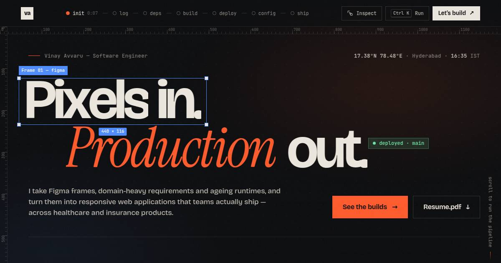

# Pixels in. Production out.

The portfolio of **Vinay Avvaru**, Software Engineer (Hyderabad). It's built with React and Vite, uses no UI framework and no templates, and has two runtime dependencies (`react`, `react-dom`).



---

## The concept

The whole site plays out as a CI/CD pipeline run. Each section is a stage of a build, and the build is Vinay:

| Stage | Command | Section |
|---|---|---|
| `01 init` | `git clone vinay-avvaru` | Hero: a design-tool canvas with rulers, crosshair guides and a selected Figma frame (*Pixels in.*) that ships (*Production out.*, `● deployed · main`) |
| `02 log` | `git log --graph --reverse` | Engineering story as a git graph. `main` is the career, `edu` is education, `side` is hackathons, talks and leadership. `checkout -b software-engineering` marks the move from Chemical Engineering into software |
| `03 deps` | `npm ls --depth=0` | Skills as an interactive `package.json`. Each dependency shows the products it shipped in. No skill bars, no self-ratings |
| `04 build` | `npm run build` | Projects as "release artifacts". Each opens a case file with the brief, contribution, challenges, stack and links |
| `05 deploy` | `kubectl rollout history` | Experience as versioned releases (`v0.1.0` → `v2.0.0`) with conventional-commit changelogs |
| `06 config` | `cat .engineeringrc` | Philosophy: a manifesto that lights up as you scroll, plus rules where each one cites real evidence |
| `07 ship` | `gh pr create` | Contact: the enquiry form is styled as opening a pull request |

The top bar is a live pipeline. The stage you're reading is `running` and earlier stages turn `passed`. Each stage keeps its own timer.

**Extras**
- **Boot sequence.** A terminal "build" plays once per browser session. Press any key to skip it. It's skipped automatically when the visitor prefers reduced motion.
- **Command palette.** Open it with `⌘K` / `Ctrl K` (or `/`). It can jump to stages, open case files, copy the email address, download the resume and toggle inspect mode.
- **Inspect mode.** Press `I` or the top-bar button, then hover anything to see its element, class and rendered size, DevTools-style.
- **Deep links.** `/#build/keycloak` opens that case file directly.

**Design system** (`src/styles/tokens.css`)
- Palette: graphite ink `#0b0c0e` and warm paper `#ece7de`, plus signal vermilion `#ff5a2b` for build/action, pass green `#6fe3a5` and design-tool selection blue `#4f8cff`.
- Type: **Bricolage Grotesque** for display, **Instrument Serif** italic for accent words and **JetBrains Mono** for system text.
- Motion: masked letter/word reveals, staggered scroll reveals, a scroll-lit manifesto and a cursor-reactive dot field. Everything respects `prefers-reduced-motion`.

---

## Run it locally

Requires **Node 20.19+** (Node 22 recommended — there's an `.nvmrc`).

```bash
nvm use
```

```bash
npm install
```

```bash
npm run dev
```

The dev server runs at http://localhost:5173. Other scripts:

```bash
npm run build
```

```bash
npm run preview
```

`build` writes the static site to `dist/`. `preview` serves that production build locally.

---

## Editing content

**All copy lives in [`src/data/content.js`](src/data/content.js), and the resume is its source of truth.** Sections render from this file, so you rarely need to touch components.

- **Project links.** Each build has `links: { github: null, live: null }`. Add a URL and the case file shows a "Live demo" or "Source" button. While both are `null`, the case file says the work is private to the company.
- **Skills.** `skills[].items[].used` lists build ids (`'4healths'`, `'channel360'`, …), which become the "shipped in →" chips.
- **Personal details and links.** These live in [`src/config.js`](src/config.js). Set `showPhone: true` to list your phone number.
- **Resume.** Replace `public/resume/Vinay_Avvaru_Software_Engineer.pdf` (keep the name, or update `config.links.resume`).

The resume has no databases or state-management libraries, so those categories aren't shown. To add them, add a group to `skills`.

---

## Enquiry form: setting up email delivery

A browser cannot send email by itself. The form posts to a third-party form service, and that service emails you. The code supports two services plus a fallback, with no SDKs installed (both are called with `fetch`):

| Provider | Free tier | What you need |
|---|---|---|
| **Formspree** (recommended, simplest) | 50 submissions/month | one Form ID |
| **EmailJS** | 200 emails/month | Service ID, Template ID, Public Key |
| **mailto** (fallback) | — | nothing; it opens the visitor's email app with the message prefilled |

**If no provider is configured, the form automatically uses mailto.** That's the state it ships in, so the form works from day one. The button reads "Open in email app" and the success message says so honestly.

### Option A: Formspree

1. Sign up at https://formspree.io and create a **New Form**, sending to `saivinai9050@gmail.com`.
2. Copy the form ID from the endpoint `https://formspree.io/f/xxxxabcd`. The ID is `xxxxabcd`.
3. Create a `.env` file in the project root:
   ```
   VITE_CONTACT_PROVIDER=formspree
   VITE_FORMSPREE_ID=xxxxabcd
   ```
4. Restart `npm run dev`. The button changes to **Create pull request**.
5. Send a test message. Formspree asks you to confirm the first submission by email.
6. Recommended: in the Formspree form settings, restrict submissions to your domain.

### Option B: EmailJS

1. Sign up at https://www.emailjs.com.
2. Go to **Email Services**, add Gmail (or another service) and copy the **Service ID**.
3. Go to **Email Templates** and create a template. Copy its **Template ID**. The template must use these variables:
   - Subject: `[Portfolio] {{subject}}`
   - Body: `From: {{from_name}} <{{reply_to}}>` followed by `{{message}}`
   - Reply-To: `{{reply_to}}`
4. Go to **Account → General** and copy the **Public Key**.
5. Create a `.env` file:
   ```
   VITE_CONTACT_PROVIDER=emailjs
   VITE_EMAILJS_SERVICE_ID=service_xxx
   VITE_EMAILJS_TEMPLATE_ID=template_xxx
   VITE_EMAILJS_PUBLIC_KEY=xxxxxxxx
   ```
6. Recommended: under **Account → Security**, add your domain to the allowed origins.

You can also put these values straight into `src/config.js` instead of `.env`. They are **public by design**: a Formspree ID and an EmailJS public key ship to every visitor's browser. Abuse protection comes from the domain restrictions above and the form's built-in honeypot field.

**What the form does:** it validates inline (on blur and on submit) and moves focus to the first invalid field. While sending, it shows a "Running checks…" loading state. Delivery times out after 15 seconds. On failure it shows an error that keeps the message and offers a prefilled mailto link. A hidden honeypot field quietly drops bots. Status messages use `aria-live`.

---

## Deploying

It builds to a static `dist/` folder, so any static host works.

### Vercel
Import the repo at https://vercel.com/new. Vite is detected automatically (build `npm run build`, output `dist`). Add the `VITE_…` form variables under **Settings → Environment Variables**.

### Netlify
Go to **Add new site → Import from Git**. Use build command `npm run build` and publish directory `dist`. Add the `VITE_…` variables under **Site configuration → Environment variables**.

### Cloudflare Pages
Use framework preset **Vite** (build `npm run build`, output `dist`), and add the `VITE_…` variables.

### GitHub Pages (workflow included)
1. Push this repo to GitHub.
2. Go to **Settings → Pages → Source** and choose **GitHub Actions**.
3. Under **Settings → Secrets and variables → Actions → Variables**, add `VITE_FORMSPREE_ID` (or the EmailJS variables).
4. Push to `main`. [`.github/workflows/deploy-pages.yml`](.github/workflows/deploy-pages.yml) builds with `BASE_PATH=/<repo-name>/` and publishes the site.

If you use a custom domain on Pages, change `BASE_PATH` in the workflow to `/`.

### Before going live
- [ ] Replace `https://vinay-avvaru.dev` with your real domain in `src/config.js`, `index.html` (canonical, Open Graph, JSON-LD), `public/robots.txt` and `public/sitemap.xml`.
- [ ] Configure Formspree or EmailJS, then send yourself a test enquiry.
- [ ] Add live or GitHub links to any projects that have public versions.
- [ ] Optional: regenerate `public/og-image.png` (1200×630) if you change the hero.

---

## Project structure

```
src/
  config.js              ← links, email, form provider (edit to go live)
  data/content.js        ← every word on the site, from the resume
  context/UIContext.jsx  ← stage tracking, case file, palette, inspect, toast
  hooks/                 ← reveal observer, stage tracker, focus trap, magnetic, clock
  lib/                   ← mailer (Formspree / EmailJS / mailto), utils
  components/            ← Boot, TopBar, CommandPalette, CaseDrawer, Inspector, Mock (SVG sketches), SplitText…
  sections/              ← Hero (+ HeroField canvas), Story, Arsenal, Builds, Deploys, Philosophy, Contact
  styles/                ← tokens, base, chrome (site UI), sections
public/                  ← resume PDF, favicon, OG image, robots, sitemap
```

## Quality notes

- **Performance.** There's one shared `IntersectionObserver` for every reveal. The hero canvas only redraws while the pointer moves and only while it's visible, and its pixel ratio is capped at 2. Scroll handlers are throttled with `requestAnimationFrame`. Animations use `transform`/`opacity` only. The production JS bundle is about 91 KB gzipped.
- **Accessibility.** The site has semantic landmarks and a skip link. Dialogs (case file, palette) trap focus, close with Esc and return focus to what opened them. Everything works from the keyboard. Split-text headings expose their plain text to screen readers. Under `prefers-reduced-motion`, all motion is disabled and the boot sequence is skipped.
- **SEO.** The page has a title and description, canonical URL, Open Graph and Twitter cards, `Person` JSON-LD, robots.txt, a sitemap and a `<noscript>` summary.
- **Responsive.** Tested at 390, 1024, 1200 and 1440 px wide with no horizontal overflow. On phones, the pipeline collapses to dots, the case-file previews appear inline, and the cursor-only effects turn off.
